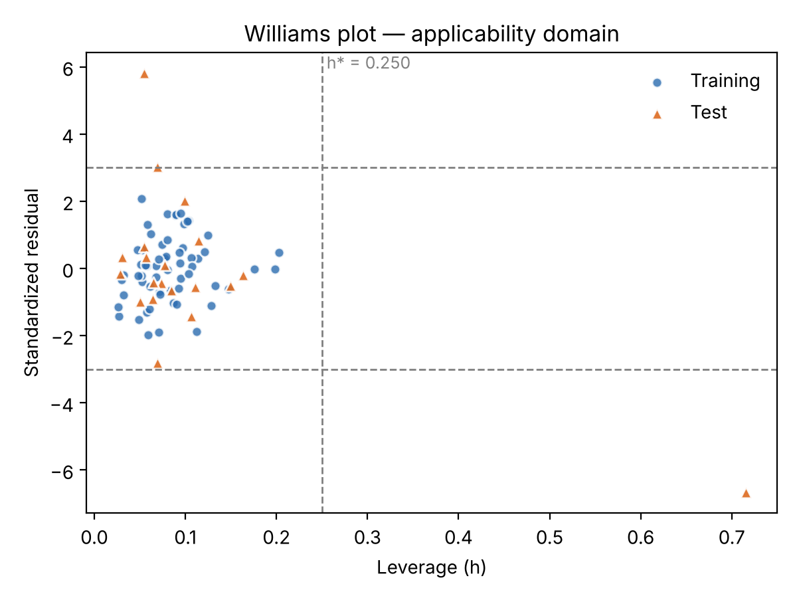
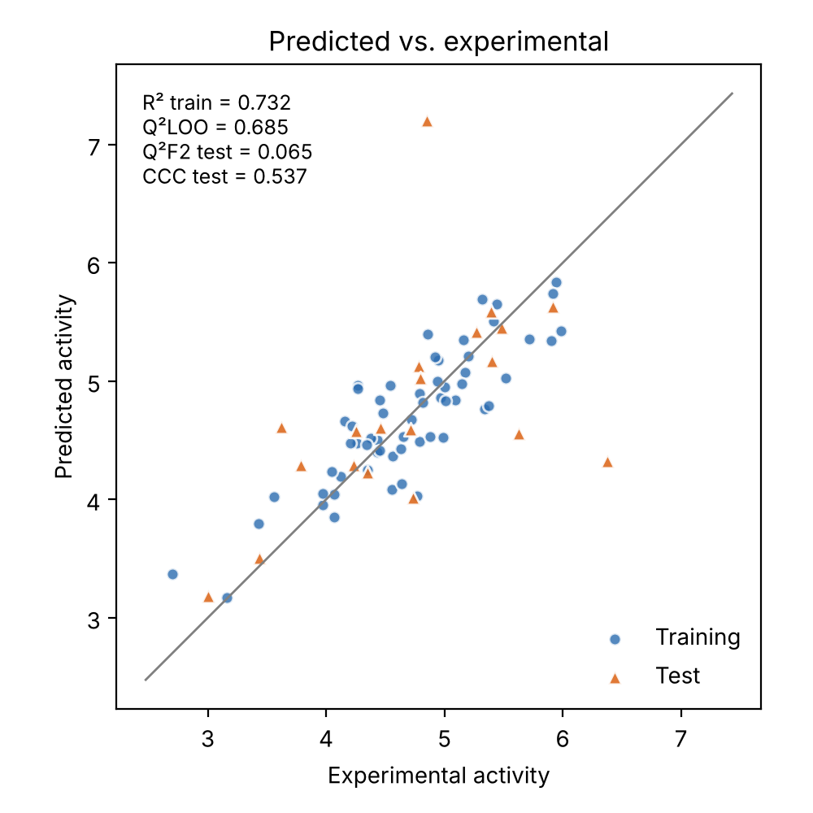
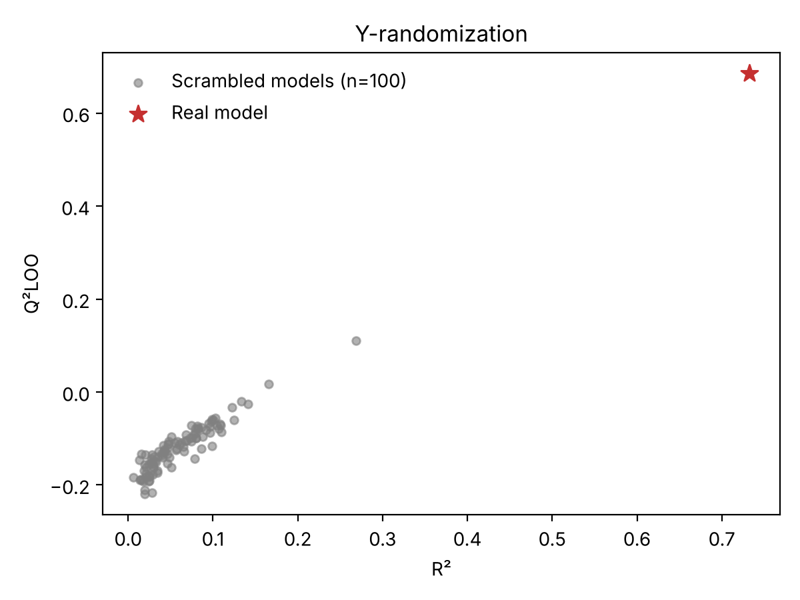

# QSAR Model Validation Toolkit

Open-source Python tools for checking whether a multiple linear regression (MLR) QSAR model can be trusted on new compounds. Given a descriptor table with a train/test split, it fits the model and produces:

- **Applicability domain:** leverage-based Williams plot and a per-compound report flagging predictions outside the domain
- **Y-randomization:** refits on shuffled activities to rule out chance correlation
- **External validation:** R², RMSE, Q²F1, Q²F2, Q²F3 and the concordance correlation coefficient (CCC), for the whole test set and for test compounds inside the domain
- **Internal validation:** leave-one-out Q²

This is an independent implementation of standard, published methods (references below), written from scratch.

## Quick start

```bash
git clone https://github.com/mariamz12/qsar-model-validation.git
cd qsar-model-validation
pip install -r requirements.txt

python examples/make_example_data.py          # builds a small synthetic dataset
python -m qsar_validation examples/example_dataset.csv \
    --activity pIC50 --split split --id compound_id --out results/
```

## Input format

A CSV with one row per compound:

| compound_id | MolLogP | TPSA | … | pIC50 | split |
|---|---|---|---|---|---|
| CPD-001 | 2.86 | 71.3 | … | 5.12 | train |
| CPD-002 | 1.94 | 102.5 | … | 4.03 | test |

- `--activity`: the response column
- `--split`: a column with `train` or `test` in each row
- `--descriptors`: comma-separated descriptor columns (default: every other numeric column)
- `--n-yrand`: Y-randomization iterations (default 100)

## Outputs

| File | Contents |
|---|---|
| `metrics.json` | All internal, external and Y-randomization metrics, plus h* |
| `applicability_domain.csv` | Per compound: predicted value, leverage, standardized residual, inside/outside domain |
| `williams_plot.png` | Leverage vs. standardized residual, with h* and ±3σ limits |
| `predicted_vs_experimental.png` | Parity plot for training and test sets |
| `y_randomization.png` | Real model vs. scrambled models in R²–Q² space |

## Example

The example uses **simulated data** (not real compounds or measurements): 80 compounds, 4 descriptors, and two planted problem compounds.



The Williams plot catches both problem compounds. One sits far beyond h* = 0.25, so the model is extrapolating to it. The other is a response outlier with a standardized residual above 5. A third, borderline compound falls just over the 3σ limit.

| Metric | Value |
|---|---|
| R² (training) | 0.732 |
| Q²LOO | 0.685 |
| Best Q²LOO among 100 scrambled models | 0.111 |
| Q²F2, whole test set | 0.065 |
| Q²F2, test compounds inside the domain (85%) | 0.772 |
| CCC, test compounds inside the domain | 0.873 |

Two lessons show up here. Y-randomization confirms the model is real signal, since no scrambled model comes close. And a few out-of-domain compounds can wreck external metrics, which is why predictions should always be reported with their applicability domain.

<p float="left">
  
  
</p>

## Use as a library

```python
from qsar_validation import validate

res = validate(X_train, y_train, X_test, y_test, n_yrand=100)
print(res.metrics["Q2_LOO"], res.metrics["Q2_F2"], res.h_star)
```

## Tests

```bash
pip install pytest
python -m pytest
```

The tests check each metric against an independent calculation. For example, training leverages must sum to p + 1, and LOO Q² must match an explicit refit loop.

## Methods

- **Leverage:** hᵢ = xᵢᵀ(XᵀX)⁻¹xᵢ, with the hat matrix built from the training set only. Warning leverage h* = 3(p + 1)/n.
- **Standardized residuals:** divided by the training residual standard deviation, √(SSE / (n − p − 1)).
- **Q²F1, Q²F2, Q²F3:** external Q² variants using the training mean, the test mean and per-compound normalization, respectively.

## References

- Gramatica, P. (2007). Principles of QSAR models validation: internal and external. *QSAR & Combinatorial Science*, 26(5), 694–701.
- Rücker, C., Rücker, G., & Meringer, M. (2007). y-Randomization and its variants in QSPR/QSAR. *J. Chem. Inf. Model.*, 47(6), 2345–2357.
- Chirico, N., & Gramatica, P. (2011). Real external predictivity of QSAR models: how to evaluate it? *J. Chem. Inf. Model.*, 51(9), 2320–2335.

## Related work

These validation steps reflect my Ph.D. research on ML-based QSAR modeling of antidiabetic enzyme inhibitors:

- Zamani, M.; Casanola-Martin, G. M.; Rasulev, B. *Machine Learning-based QSAR Modeling of α-Amylase Inhibitors as Potential Antidiabetic Agents.* Preprint, 2025.
- Zamani, M.; Casanola-Martin, G. M.; Rasulev, B. *Unlocking the Potential of α-Glucosidase Inhibitors: A Computational Machine Learning Approach.* Submitted, 2025.

## License

MIT. See [LICENSE](LICENSE).
